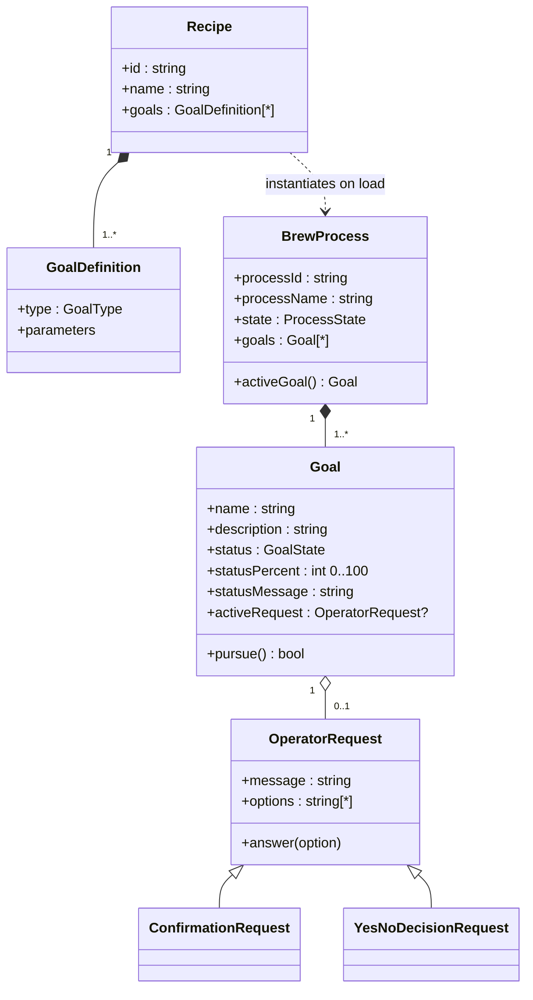
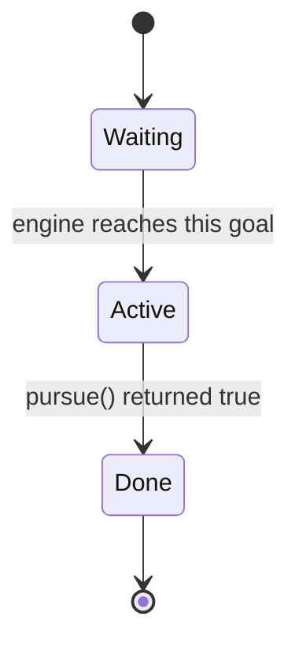

# 02 — Domain Model

## 2.1 Recipe

- `DOM-001` A **recipe** is an immutable definition consisting of
  - `id` — unique short identifier (e.g. `ZORA`, `HIPA`, `TEST`); used by the UI to load it.
  - `name` — display name (e.g. `München 12.6 - SUD1:ZORA`).
  - `goals` — ordered, non-empty list of goal definitions (type + parameters, see [04](04-goal-types.md)); in the recipe file they are in the section `mashing_process` ([07](07-recipes.md) §7.2).
- `DOM-002` Recipes are provided by a recipe catalogue (see [07](07-recipes.md)). The catalogue preserves the order in which recipes are defined; this order is used in the UI.
- `DOM-003` Recipe IDs are unique within the catalogue. Lookup by ID of an unknown ID yields "not found" (never a crash). `[FIX-10]`

## 2.2 Brew process

- `DOM-010` A **brew process** is a runtime instance of a recipe. It carries `processId` (= recipe id), `processName` (= recipe name), the lifecycle `state` (see [03](03-brew-process-engine.md)) and an ordered list of **goal instances**.
- `DOM-011` Every *load* of a recipe creates a **fresh** brew process with fresh goal instances (all `Waiting`, no timers started, no start temperature captured, no requests). Goal instances are never shared between two loads. `[FIX-08]`
- `DOM-012` The **active goal** of a process is the first goal with status `Active`; at most one goal is `Active` at any time. If none is active, there is no active goal.
- `DOM-013` Two brew processes are considered equal if their `processId` is equal (legacy semantics; relevant only if a technology uses equality).

## 2.3 Goal

- `DOM-020` A **goal** is one step of a brew process. Every goal exposes:

| Field | Type | Meaning |
|-------|------|---------|
| `name` | string | Short title, e.g. `Heat Up`, `Rest`, `Mash In` |
| `description` | string | One or more lines of explanatory text. May change at runtime (iodine test appends text). May contain line breaks. |
| `status` | `Waiting` \| `Active` \| `Done` | Lifecycle state |
| `statusPercent` | integer 0…100 | Progress of the goal, clamped to 0…100 `[FIX-14]` |
| `statusMessage` | string | Human-readable progress, e.g. `50%` or `12:30 left` (never null/undefined `[FIX-14]`) |
| `activeRequest` | OperatorRequest or absent | Request currently waiting for an operator answer |

- `DOM-021` **Goal state machine**

  A goal never goes back to `Waiting`. A stopped process leaves its goals in their current state (for display) until it is unloaded or re-loaded.

- `DOM-022` Default progress for goal types without own progress logic: `statusPercent = 0` while `Waiting`/`Active`, `100` when `Done`; `statusMessage = "<statusPercent>%"`.
- `DOM-023` When a goal becomes `Done`, any active request of that goal is removed.

## 2.4 Operator request

- `DOM-030` A goal MAY have at most **one** active operator request. A request has a `message` (question/instruction text) and an ordered list of answer `options`.
- `DOM-031` Request types:

| Type | Options (exact strings) | Result after answer |
|------|-------------------------|---------------------|
| `ConfirmationRequest` | `["Confirm"]` | `confirmed = true` |
| `YesNoDecisionRequest` | `["Yes", "No"]` | `yes = true` or `no = true` |

- `DOM-032` Answers are matched **case-sensitively** against the options. An answer that is not one of the options is rejected; the request stays unanswered and the sender receives an error reply (legacy: only logged). `[FIX-11]`
- `DOM-033` While a request is active, the buzzer plays the **long beep** pattern immediately and then repeats it every **10 s** (configurable, `ui.requestReminderIntervalSeconds`) until the request is answered, removed, the goal is done, or the process is stopped, paused or unloaded. There is never more than one reminder loop at a time. `[FIX-12]`
- `DOM-034` Requests are shown in the UI as the request message plus one button per option (see [09](09-user-interface.md)).
- `DOM-035` `[NEW]` Every request has an `id` that is unique while the server runs; a new question (e.g. the iodine test asked again after "No") is a new request with a new id. An answer names the request it answers, so a late click on an earlier question is rejected instead of answering the current one (`IF-054`, `Q-28`).

## 2.5 Enumerations

- `GoalState`: `Waiting`, `Active`, `Done` (serialised exactly with this spelling).
- `ProcessState` `[NEW, FIX-20]`: `Loaded`, `Running`, `Paused`, `Finished`, `Stopped` (see [03](03-brew-process-engine.md)). When no process is loaded, the engine state is `NoProcess`.
- `GoalType`: `PourInBrewingWater`, `HeatUp`, `MashIn`, `Rest`, `IodineTest`, `Lautering`, `HeatUpForHopsCooking`, `CookWater` (see [04](04-goal-types.md)).
